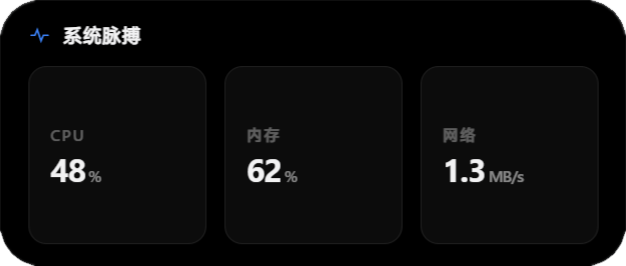
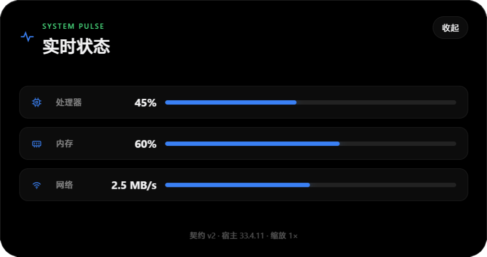
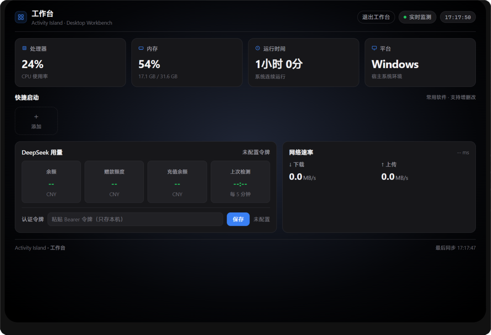

# Activity Island

Windows 桌面灵动岛。一个 Electron 宿主进程负责屏幕顶部的"岛"本身，所有功能由**独立网页插件**提供 —— 插件内容被宿主逐帧裁剪，跟着岛的外壳一起生长、收缩。以下截图均来自真实运行画面（见 `docs/images/`）。

## 软件特点

- **宿主与插件彻底分离**：插件是普通网页，不依赖任何前端框架；宿主不关心插件内部实现，两者只通过契约化的 SDK 通信。
- **弹簧动画外壳**：展开、收起、提醒、悬停全部由宿主统一驱动，带过冲与回弹；插件永远与岛同步出现，不会先出黑壳再等内容。
- **三态渐进披露**：小岛扫一眼 → 中岛看重点 → 大岛看全景。
- **提醒与独占仲裁**：覆盖式提醒自动退场、独占展开可被打断；用户操作（悬停、点击）永远优先于插件发起的请求。
- **零内置插件**：本地目录安装或 `.islandplugin` 包导入，改文件自动热重载；配套的生成规范（Skill 包）可装给本地 AI，让 Claude Code 等按契约写插件。
- **参数与日志归宿主**：插件只声明参数字段，表单与日志在控制台内嵌展示，插件不必自己造设置界面。

## 总览架构

```text
┌────────────────────────── Electron 主进程（宿主）──────────────────────────┐
│  IslandLayoutManager   IntentArbiter（提醒/独占仲裁）                       │
│  PluginManager         （扫描 / 校验 / 安装 / 卸载）                        │
│  PluginViewManager     （每个插件一个原生视图 + 统一裁剪父容器）             │
│  PluginBackgroundManager（后台脚本输出 → 插件事件）                         │
│  PluginWatcher         （开发目录改动 → 同步 + 热重载）                     │
└───────┬───────────────────────────────┬────────────────────────────────────┘
        │ 布局 / 提醒光圈                │ 可见性 / 尺寸 / 模式
┌───────▼───────────────┐    ┌──────────▼─────────────────────────────────┐
│ 岛壳渲染层（透明窗口内）│    │ 插件页面 × N（独立渲染进程，普通网页）        │
│ 弹簧动画 / 分隔线 / 光圈│    │ 由宿主按当前状态裁剪显示                     │
└───────────────────────┘    └────────────────────────────────────────────┘
```

「控制台管理」是唯一的桌面管理入口（设置 / 插件安装与管理 / 工作台管理），与岛互不干扰；工作台本体右键小岛打开。

---

# 第一部分：灵动岛（Host）

宿主负责一切"岛"本身的东西：窗口与命中检测、外壳弹簧动画、布局与仲裁、插件视图生命周期、插件参数表单与日志。**插件不画外轮廓** —— 黑色胶囊、圆角、磨砂边框、光圈全部由宿主绘制。

## 六种状态

### ① 待机 · 浮动

无插件时是屏幕顶部居中的一枚黑色小胶囊，半透明悬浮在桌面之上；悬停会轻微放大。


有常驻插件时，浮动模式会直接把 mini 条留在屏幕上。

### ② 待机 · 收起

"收起"空闲表现下，整座岛缩成屏幕顶边的一条窄带（64×8），平时几乎隐形；鼠标移入立即展开为 mini 条。


### ③ mini 条（compact）

多个插件并排成一条横栏：每段是一个插件的 small 视图，段间由宿主绘制 1px 分隔线；放不下时尾部折叠成 `+N`，点它直达插件设置。


- 段宽由插件声明，顺序 = 用户排序 > 插件优先级 > 名称
- 插件可以自报"暂时没内容"而从条上消失（截图中的媒体与通知插件此时未上岛）
- 收起模式下鼠标移开即缩回触发条；浮动模式停留 3 秒

### ④ 提醒覆盖态（alert）

插件声明提醒时，整条 mini 被这一条提醒覆盖：画面是插件自己的 small 视图，岛缘亮起 1px 语义色光圈与光晕（普通级只描边）。停留时长按级别自动退场（普通 4s / 警告 6s / 严重 9s），插件也可以自定义光圈颜色。


不同档位与自定义颜色的边缘光圈：

| info · 蓝色细线 | warn · 琥珀光晕 |
|---|---|
|  |  |
| **critical · 红色光晕** | **自定义颜色 · 紫色光圈** |
|  |  |

### ⑤ 中岛（expanded）

点击任意插件段进入：一次只显示一个插件，放主信息和一个主操作，其余插件隐藏。



### ⑥ 大岛（detail）

中岛再点一次进入：更完整的分组信息、历史与统计，底部弱化辅助信息。



### ⑦ 工作台（custom）

可替换的桌面控制面板（系统监测、快捷启动等），独立目录、独立能力确认，从托盘或右键打开。



## 状态流转

```text
                 悬停触发条 / 悬停胶囊
   收起条 ───────────────────────▶ mini 条 ──点插件段──▶ 中岛 ──再点──▶ 大岛
      ▲                              │                    │              │
      │        鼠标移开（收起模式）     │ 鼠标移开(浮动延时)   │  插件收起操作  │
      └──────────────────────────────┴────────────────────┴──────────────┘

   提醒：mini 状态下插件发起 → 整条覆盖（用户操作可打断）→ 到期回到原状态
```

优先级：**用户操作 > 独占展开 > 提醒队列 > mini 常驻**。

## 动画

外壳是一个 CSS 弹簧，逐帧渲染并上报尺寸给主进程；主进程同步原生裁剪窗，让插件内容与胶囊逐帧对齐。展开带过冲回弹（~3%），收起更快且不过冲；岛渲染进程崩溃会自动重载恢复，不用重启应用。

---

# 第二部分：插件（Plugin）

插件是**一个普通网页**：一个清单文件（`plugin.json`）加一个 `dist/` 静态目录，不需要构建器，宿主也不关心你用什么框架。

## 一个插件声明什么

清单里描述四类信息，其余全是网页本身：

- **身份**：id、名称、版本
- **三态尺寸**：small 段占多宽、中岛/大岛多大
- **参数**：要用户填的东西（文本/密码/数字/开关/下拉/颜色），宿主控制台自动渲染表单
- **后台脚本**（可选）：读本机数据或联网的唯一途径，PowerShell 或 Node，输出一行 JSON 就是一个事件

## 三态视觉规范

插件与岛融为一体的关键：**外轮廓归宿主，插件只管内容安全区**。根背景透明或纯黑，不画外层圆角/边框/阴影，不做悬停缩放。

| 状态 | 内容内边距 | 区块间距 | 放什么 |
|---|---|---|---|
| small（~40px 高） | 左右 14px | 8px | 只放 [身份图标 18px] + [数值 16px]，一眼可读 |
| medium | 16px 20px | 12px | 一个主信息 + 一个主操作 |
| large | 24px 28px | 20–24px | 分组信息；危险操作弱化到底部 |

- small 段公式：**[身份标记] + [数值]**，别的全部不要（文字标签、副标题、滚动字幕都禁止）
- 图标用细线 SVG（约 1.8px 描边），禁止 Emoji 当图标
- 数字用等宽数字排版，跳动时宽度稳定
- 语义色只表达状态：蓝=主操作、绿=正常、橙=警告、红=错误

## 插件能做什么

- **三态展示**：同一份代码按当前模式渲染 small / medium / large 内容
- **上下岛**：常驻占位，或"有内容才出现"（没在播放音乐就不占条）
- **整条提醒**：覆盖式提醒 + 语义色光圈，支持自定义颜色
- **请求独占展开**：排队/打断/过期都有明确回执
- **跨插件事件与本地存储**：插件之间可广播事件，各自有持久化键值存储
- **全局媒体键**：不用写后台脚本就能控制系统播放
- **日志**：写入日志文件，控制台里直接看

**三条必须记住的规则**：

1. small 段的点击要插件自己挂（点一下进中岛、再点进大岛），宿主不会代劳；small 容器要铺满整个视图。
2. "有内容才出现"的判断必须事件驱动 —— 被摘下后插件的轮询会暂停，靠轮询醒不过来。
3. 读本机数据/联网必须走后台脚本，页面本身没有这个能力。

## 开发工作流

- **脚手架**：`npm run new-plugin -- my-plugin "我的插件"` 生成空壳
- **安装**：控制台管理「插件 → 选择目录安装」选中开发目录，立即生效并记住源码目录
- **热重载**：改开发目录文件 → 自动同步 + 重载页面（约 0.5s）
- **AI 生成**：控制台「插件 / 工作台 → 下载 Skill 包」，解压到本地 AI（Claude Code 等）的 skills 目录，AI 读 SKILL.md 按契约生成
- **打包分发**：插件列表「导出」一键生成 `.islandplugin`，对方「导入插件包」直接用
- **自检**：`pwsh -File scripts/plugin-smoke.ps1 -PluginDir <插件目录>`
- **管理**：启用/禁用、排序、参数、日志、重载、卸载都在「控制台管理 → 插件」内嵌完成

## 当前示例插件（`island-plugin/` 独立目录）

| 插件 | small 段 | 说明 |
|---|---|---|
| 时钟 demo-clock | ⏰ 20:00 | 中岛大字时间 + 当日进度，大岛进度环 |
| 系统状态 demo-status | ⚙ 47% | 三张指标卡（CPU/内存/网络）+ 大岛图标进度行 |
| DeepSeek 余额 | 💰 ¥12.48 | 余额查询（本地代理），大岛余额总览 |
| 专注节奏 focus-flow | ● 24:38 | 番茄钟：滚轮选时长、进度环计时、今日统计 |
| 媒体控制 smtc-media | ♪ 波形 | 系统媒体控制：封面、波形、播放控制，没在播放自动隐藏 |
| 端口通知 port-notify | 按需 | HTTP POST 一条 JSON 就能推提醒到岛 |
| 契约自检 contract-probe | — | 探针（测试用） |

---

# 快速开始

```powershell
cd island-main
npm install
npm run dev            # 开发模式（renderer 热更新）

npm run dist           # NSIS 安装包 → release\Activity Island-<版本>-setup.exe
npm run dist:portable  # 免安装单文件 exe
```

- 安装/卸载都不动用户数据：插件、日志、设置都在 `%APPDATA%\dynamic-island-host\`。
- 灵动岛不内置任何插件，首次启动是空岛 —— 在「控制台管理 → 插件」装一个，或用本地 AI（下载 Skill 包）生成一个。

# 测试矩阵

```powershell
npm run test:contract   # 排序/装箱/仲裁/打包纯逻辑
npm run test:ui         # 控制台管理页面
npm run test:settings   # 控制台管理·插件页
npm run test:bg         # 后台脚本端到端
npm run test:click      # 点击进中岛 + 岛渲染进程崩溃自愈
npm run test:presence   # 插件按需出现
npm run test:anim       # 外壳动画逐帧采样
npm run test:geo        # 收起/展开原生几何逐帧
npm run test:pack       # 插件包导出导入回环
npm run test:workbench  # 工作台 API / 页面 / 管理页
npm run test:dist       # 打包产物验收（需先 npm run dist）
pwsh -File scripts/tests/contract-e2e.ps1    # 意图仲裁端到端
pwsh -File scripts/tests/phase-c-e2e.ps1     # 日志/页面异常/热重载端到端
```

# 文档索引

| 文档 | 内容 |
|---|---|
| [`docs/architecture.md`](docs/architecture.md) | 宿主架构与模块划分 |
| [`docs/plugin-contract.md`](docs/plugin-contract.md) | 插件契约 v2 全文（消息、尺寸、主题、性能、能力） |
| [`docs/plugin-requirements.md`](docs/plugin-requirements.md) | 插件视觉与行为要求 |
| [`docs/workbench-contract.md`](docs/workbench-contract.md) | 工作台契约（能力模型、内容管理） |
| [`design/DESIGN.md`](design/DESIGN.md) | 设计规范（视觉语言、token、动效原则） |
| [`skills/`](skills/) | 插件 / 工作台生成规范（SKILL.md，可装给本地 AI） |

