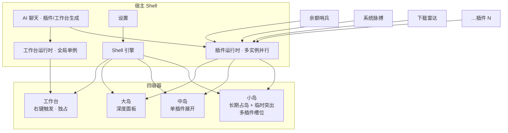

# 灵动岛 · 产品设计规格

> Activity Island — Windows 桌面信息岛  
> 容器：小岛 / 中岛 / 大岛 / 右键工作台；内容由插件驱动；附 AI 聊天与设置。

视觉规范见同目录上级 `DESIGN.md`。

---

## 1. 一句话

**把「需要一直看见的状态」和「必须立刻知道的消息」收进桌面上一个可伸缩的岛，其余深度工作交给一次只开一个的工作台。**

## 2. 信息架构总览



## 3. 四容器职责

### 3.1 小岛（Small Island）

| 项 | 设计 |
|---|---|
| 形态 | 顶栏附近黑色胶囊，height 36–44，radius 999 |
| 内容 | **多个插件槽位**并排：状态点 + 短标签/短值（如 `● 余额 ¥2.56`） |
| 模式 A · 长期占岛 | 插件申请驻留槽，周期性刷新；用户可在设置里排序/开关 |
| 模式 B · 临时突出 | 高优先级消息 **插入岛中央或替换槽内容 2–6s**，带 accent 光晕，到时回落到驻留态 |
| 交互 | 悬停/点击某槽 → 中岛展开该插件；右键 → 工作台或宿主菜单；中键/快捷键可收起 |
| 槽位规则 | 默认可见槽 ≤4（可配 3–5）；第 5 个起显示 `+N`；临时消息不占用永久槽，结束即释放 |
| 优先级 | `critical > high > normal驻留`；同级临时消息队列，不叠岛 |

**小岛槽布局（示意）**

```
╭──────────────────────────────────────────╮
│ ● 余额 ¥2.56    ⬇ 2.4MB/s    ● 专注 25m   +2 │
╰──────────────────────────────────────────╯
```

### 3.2 中岛（Medium Island）

| 项 | 设计 |
|---|---|
| 触发 | 点击小岛槽位 / 临时消息「详情」/ 快捷键 |
| 形态 | 约 320–420 宽，radius 24，深色卡片 |
| 内容 | **单一插件**的标准展开：标题行 + 1–2 列指标卡 + 状态/下次更新 + 动作 |
| 交互 | 头部「收起」回小岛；「打开工作台」跳该插件工作台模块；Esc 收起 |
| 生命周期 | 与焦点绑定；点击岛外收起；可选「钉住中岛」让其持续显示 |

**中岛信息模板（与截图一致）**

```
● DeepSeek 余额                    [刷新] [收起]
┌─────────────┐ ┌─────────────┐
│ 余额        │ │ 累计消费    │
│ ¥2.56       │ │ ¥157.44     │
└─────────────┘ └─────────────┘
正常                    更新 14:59:37 · 下次 03:51
```

### 3.3 大岛（Large Island）

| 项 | 设计 |
|---|---|
| 触发 | 中岛内「展开」/ 小岛双击 / 插件声明 `surface: large` |
| 形态 | 420–560 宽或按插件 `maxWidth`，radius 28，可内部滚动 |
| 内容 | **一个插件或「聚合视图」**：多模块（列表、图表、快捷操作），仍低于工作台复杂度 |
| 与工作台边界 | 大岛=聚焦单域深看；工作台=跨插件全景 + 参数 + 快捷启动 |
| 交互 | 同中岛收起逻辑；可把大岛「升入工作台」对应模块 |

### 3.4 工作台（Workbench）

| 项 | 设计 |
|---|---|
| 触发 | **右键**岛体/托盘/桌面热区 →「打开工作台」；或中/大岛入口 |
| 约束 | **全局同时仅 1 个工作台**；再次打开聚焦已有实例并可切换预设 |
| 形态 | 浮层 ~920×560，radius 20，顶栏 + 模块网格 + 底栏参数 |
| 顶栏 | 工作台名称 · 退出工作台 · 实时监测开关 · 时钟 |
| 模块区 | 由当前工作台配置的插件贡献模块（卡片/面板） |
| 底栏 | 该工作台参数（刷新频率、主题色、开关），保存后生效并保留 |
| 内容策略 | 模块必须回答一个问题；可折叠；用户可增删模块顺序 |

**默认工作台布局（系统监控 · 对齐截图）**

| 区 | 模块 | 回答的问题 |
|---|---|---|
| 顶 KPI×4 | 处理器 / 内存 / 运行时间 / 平台 | 机器现在健康吗？ |
| 中左 | 插件模块（如 DeepSeek 用量） | 关键业务余额怎样？ |
| 中右 | 网络速率 ↓/↑ | 网在动吗？ |
| 可选 | 快捷启动 | 常用应用一键打开 |
| 底 | 参数配置 | 这台工作台怎么刷数据？ |

## 4. 运行时与权限模型

```
插件 manifest（示意）
{
  "id": "ds-balance",
  "name": "DeepSeek 余额",
  "version": "1.0.0",
  "surfaces": ["small", "medium", "workbench"],
  "persistence": "resident",          // resident | transient
  "priority": "normal",               // critical | high | normal
  "refreshMs": 60000,
  "slots": { "small": 1 },
  "workbenchModule": { "id": "usage", "grid": "col-span-3" },
  "permissions": ["net:api.deepseek.com", "storage:local"],
  "aiScaffold": true                  // 可被 AI 聊天生成/改写
}
```

| 规则 | 说明 |
|---|---|
| 插件并行 | 多个插件进程/沙箱可同时刷新；UI 线程合并岛渲染 |
| 工作台独占 | 启动新工作台前提示「替换当前工作台？」；切换保留各工作台本地参数 |
| 临时消息 API | `island.notify({ title, body, priority, ttlMs, actions[] })` |
| 占岛 API | `island.reside({ compact, expanded, large })` 返回 slotId |
| 故障隔离 | 插件崩溃只掉自己的槽，岛壳显示「插件异常」占位 |
| 安装来源 | 本地包 / 目录 / AI 生成草稿；安装前权限清单确认 |

## 5. 设置页

分区（左侧导航或顶部分段）：

1. **岛基础** — 位置锚点、默认形态、显示槽位数、开机启动、透明度、圆角跟随主题  
2. **插件管理** — 列表：名称 / 版本 / 权限 / 占用容器 / 开关 / 排序 / 配置入口 / 卸载  
3. **工作台管理** — 可用工作台列表 · 启动（切换）· 默认启动项 · 模块开关 · 重置参数  
4. **临时消息** — 优先级阈值、免打扰时段、音效/仅光晕、历史清空  
5. **AI** — 模型/接口配置、生成代码确认策略、日志  
6. **关于** — 版本、日志目录、诊断导出  

**管理原则：** 开关即时生效；工作台「启动」是显式动作且全局单例；插件排序影响小岛槽位。

## 6. AI 聊天（开发插件与工作台）

| 能力 | 行为 |
|---|---|
| 生成插件 | 对话描述需求 → 产出 manifest + UI 片段 + 刷新逻辑 → 预览在中岛/大岛沙箱 → 用户确认安装 |
| 生成工作台内容 | 「做一个带 CPU/网速/余额的工作台」→ 模块布局草案 → 写入工作台配置 |
| 改写现有插件 | 自然语言改标签、刷新间隔、临时消息阈值 |
| 安全 | 默认沙箱预览；写入真实插件目录需二次确认；权限列清单 |
| 会话对象 | 可绑定「当前插件」或「空白草稿」；历史可导出 |

聊天 UI：右侧或独立浮层，不抢岛的渲染焦点；成功安装后在设置→插件高亮。

## 7. 标志性插件（建议首发生态）

### P1 · AI 余额哨兵 `ds-balance`（已有实现基础）

- **小岛：** `● 余额 ¥2.56` 长期占槽；低于阈值 `warning` 点 + 临时突出「余额偏低」
- **中岛：** 余额 / 累计消费双卡 + 状态 + 更新倒计时（对齐用户截图）
- **工作台模块：** 余额、赠款额度、充值余额、上次检测 + Bearer 令牌配置
- **临时消息：** 余额 < 阈值、API 错误、令牌失效

### P2 · 系统脉搏 `sys-pulse`

- **小岛：** `CPU 5% · MEM 84%` 或异常时 `CPU 92%`
- **中岛：** CPU / 内存 / 运行时长 / 平台
- **工作台：** 四 KPI + 进程 Top N + 网络速率（用户截图主场景）
- **临时消息：** CPU>90% 持续 30s、磁盘将满

### P3 · 下载雷达 `dl-radar`

- **小岛：** 驻留当前活动下载速度；完成后临时突出 `✓ 包完成`
- **中岛：** 任务列表、进度条、剩余时间
- **工作台：** 多任务看板、限速开关
- **临时消息：** 失败 / 校验错误 / 完成

### P4 · 会议哨兵 `meet-guard`

- **小岛：** `● 15:30 评审` 长期占岛（会前 30 分）；会前 5 分钟临时突出并可一键入会
- **中岛：** 下一场会议详情与参会人
- **工作台：** 今日日程列表、忙碌状态
- **数据源：** 本地日历 / ics / 飞书·钉钉（权限申请）

### P5 · 专注番茄 `focus-island`

- **小岛：** `● 专注 25:00` 倒计时驻留；结束临时突出
- **中岛：** 今日专注统计、休息建议
- **工作台：** 周视图、打断次数
- **与临时消息关系：** 专注中可降噪：仅 critical 打断

### P6 · 剪贴板工作站 `clip-station`

- **小岛：** 仅异常/敏感检测时临时突出（默认不驻留，避免噪音）
- **中岛：** 最近条目预览
- **工作台：** 历史搜索、置顶、类型筛选（文本/链接/图片）、清空
- **临时消息：** 检测到疑似密钥/超长内容

### P7 · GitHub 哨兵 `gh-watch`（开发者向）

- **小岛：** `● PR 3 · CI 红` 驻留
- **中岛：** 最新 CI、提及你的评论
- **工作台：** 仓库选择、通知过滤、Webhook/Token 配置
- **临时消息：** 指定仓库 CI 失败、Review 请求

### P8 · 播放条 `now-playing`

- **小岛：** 曲名/应用缩略驻留；曲目切换可轻微突出
- **中岛：** 控制条（上一首/播放/下一首）
- **工作台：** 队列、输出设备
- **注意：** 默认优先级低于系统/余额类，避免抢临时通道

### P9 · 快捷启动 `quick-launch`（工作台向）

- 不要求常驻小岛
- **工作台模块：** 网格添加常用软件/脚本/文件夹，支持拖拽排序（对齐截图「快捷启动」）
- 可从 AI 聊天：「把 VS Code、终端、Chrome 钉到工作台」

### P10 · 网速/代理链路 `net-trace`

- **小岛：** 仅切换节点或延迟飙升时临时突出
- **中岛/工作台：** 当前节点、延迟、上下行、最近探测
- 适合与系统脉搏在工作台并列

---

## 8. 工作台功能包（标志性）

### WB-A · 系统监控台 `wb-sysmon`（默认）

- 模块：处理器 / 内存 / 运行时间 / 平台 · 快捷启动 · 插件用量（DeepSeek）· 网络速率 · 参数配置
- 参数：刷新频率（如 2s）· 显示网络面板 · 主题色
- 单例启动；实时监测开关

### WB-B · 开发者座舱 `wb-devdock`

- 模块：Git 分支与干净度 · 本地服务端口 · CI 状态 · API 余额 · 构建倒计时 · 终端命令垫片
- 面向同时盯 API 成本与本地工程状态的人

### WB-C · 成本与额度台 `wb-spend`

- 模块：多服务商余额对比（DeepSeek/OpenAI/云厂商）· 本月消费曲线 · 阈值告警配置 · 导出 CSV
- 由 AI 余额哨兵扩展而来，强调「钱」

### WB-D · 专注与日程台 `wb-dayplan`

- 模块：今日日程 · 专注番茄 · 会议入会列表 · 免打扰策略
- 一次只启动这一个工作台时，替代 Outlook/日历常驻窗口

---

## 9. 关键用户流程

### 9.1 日常扫读

1. 用户瞥见小岛：余额与网速已在  
2. 余额变黄 → 5s 后回落  
3. 需要明细 → 点余额槽 → 中岛 → 可「工作台」看全量

### 9.2 临时消息打断

1. 插件 `notify` priority=high  
2. 小岛插入光晕胶囊：`⚠ DeepSeek 余额 ¥1.20`  
3. 点击 → 中岛；忽略 → ttl 结束自动回落驻留槽

### 9.3 打开工作台

1. 右键小岛 →「工作台」  
2. 若已有工作台：聚焦并提示是否切换预设  
3. 启动 `wb-sysmon`，加载 KPI 与插件模块  
4. 调整刷新频率 → 保存 → 立即生效并保留

### 9.4 用 AI 装一个新插件

1. 打开 AI 聊天：「在小岛显示我的 GitHub 未读 PR，CI 红了要突出」  
2. 生成 manifest + UI + 权限（网络 GitHub）  
3. 沙箱预览中岛效果  
4. 确认安装 → 设置插件列表出现 `gh-watch` → 自动申请小岛槽

### 9.5 插件与工作台管理

1. 设置 → 插件：关掉 `now-playing` → 小岛立即腾出槽  
2. 设置 → 工作台：设默认 `wb-sysmon`，删除不用的 `wb-devdock` 模块之一  
3. 右键再次打开 → 直达默认工作台

---

## 10. 空态 / 载入 / 错误

| 场景 | 表现 |
|---|---|
| 无插件 | 小岛显示空心点 +「安装插件」；点击打开设置或 AI |
| 插件载入中 | 槽位 skeleton 微光，不整岛 spinner |
| 插件错误 | 槽位红点 +「!」；中岛显示原因与重试；岛壳不崩 |
| 工作台无权限模块 | 占位卡片写清缺少权限与「去设置」 |
| 临时消息队列满 | 合并同类，角标 `+n`，critical 仍可插队 |

---

## 11. 与现有截图的对齐结论

| 截图 | 已验证的设计决策 | 规格中的落点 |
|---|---|---|
| 小岛余额胶囊 | 长期占岛 + 短值 + 状态点 | §3.1 模式 A · P1 |
| 中岛 DeepSeek | 单插件双指标 + 更新时间 + 刷新/收起 | §3.2 · P1 |
| 工作台系统监控 | 跨模块全景 + 快捷启动 + 参数底栏 + 单例 | §3.4 · WB-A |

后续实现应 **先固化 token 与四容器壳，再按 P1→P2→P3→WB-A 打穿主路径**，其余插件与工作台用同一契约扩展。

---

## Decision Trace（产品）

```json
[
  {
    "decision": "临时消息不占永久槽，ttl 后回落",
    "reason": "用户同时要长期占岛与临时突出；若临时消息永久替换槽位，驻留信息会丢失",
    "alternatives": ["临时消息另开第二条岛", "临时消息直接顶掉驻留且不回落"],
    "tradeoff": "需要维护临时队列与回落动画"
  },
  {
    "decision": "首发 6 插件 + 4 工作台，而非开放式市场空想",
    "reason": "设计要能被实现验证；已有 DeepSeek 与系统监控，生态应从可运行的标志性能力长出",
    "alternatives": ["只画架构不给插件清单", "一次设计 20+ 插件"],
    "tradeoff": "长尾场景覆盖不全，靠 AI 聊天后补"
  },
  {
    "decision": "AI 聊天输出必须经过沙箱预览再安装",
    "reason": "插件会申请网络与本地存储权限，直接写入有安全与稳定性风险",
    "alternatives": ["一键静默安装", "仅市场包不支持 AI 生成"],
    "tradeoff": "多一步确认，生成到可用的路径更长"
  }
]
```
