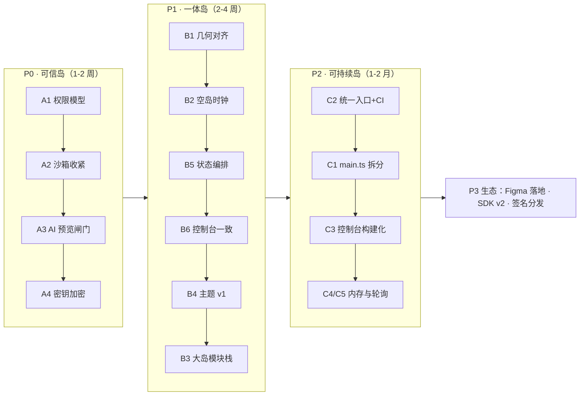

# UPGRADE.md — Activity Island 升级方案

> 基于 2026-05 现状审计：全部结论带 `file:line` 证据，可直接逐条执行。
> 视觉规范见 `design/DESIGN.md`，产品规格见 `design/docs/PRODUCT.md`，架构见 `docs/architecture.md`。

## 0. 诊断

产品已越过 MVP：token 体系落地且纪律严格、四容器闭环、插件安装/热重载/自愈完善、AI 生成链路打通、28 个测试脚本。**下一个阶段的问题不是「缺功能」，而是三件事：信任缺位、规范漂移、工程不可持续。**

| 维度 | 现状 | 评级 |
|---|---|---|
| 视觉 token 与规范 | `console-apps/theme.css` 是唯一事实源，含语义色文字变体、焦点环、reduced-motion；1 处签名几何漂移（见 B1） | A− |
| 岛壳动效 | rAF 自研弹簧积分，micro/大行程分档参数、速度继承与限幅（`src/host/main.ts:105-183`） | A |
| 四容器 | 小岛最完整（装箱/溢出/presence）；中岛完整；大岛只是「更大的 view」；工作台手写卡片 | B |
| 插件系统 | 加载校验、三层崩溃自愈、热重载风暴保护完善；**权限模型缺位、`sandbox:false`** | C |
| AI 链路 | 访谈→方案→生成、SSE 流式、路径沙箱；**生成即上岛、无预览闸门、明文密钥** | B− |
| 控制台 UI | token 引用纪律好；三个单文件 HTML 内联 JS（700/503/314 行），难演进 | B− |
| 工程化 | 28 个测试脚本覆盖面好；无统一入口、无 CI、无 lint；`electron/main.ts` 2465 行巨石 | C+ |
| 性能 | 动画帧有缓存去重；插件 view 常驻不回收、50Hz 光标轮询、2s spawn PowerShell 采网速 | B− |

---

## 1. 三条升级主线

### 主线 A · 可信岛（P0）

产品的承诺是「信息被收进一个安静的桌面器官」，但底层现状是：**任意网页 + `powershell -ExecutionPolicy Bypass` 免审上岛**（`electron/plugins/plugin-background-manager.ts:23`），AI 生成的代码写盘即运行（`electron/main.ts:330-353`），API Key 明文落盘（`electron/plugins/plugin-ai.ts:78-83`）。装一个插件等于装一个任意程序——工作台已经承认这一点并用 capabilities 确认制解决（`electron/workbench/capabilities.ts:60-63`），插件还没有。**分发出去的每一份插件都在放大这个缺口。**

| # | 升级项 | 做法 | 验收 |
|---|---|---|---|
| A1 | 插件权限模型 v1 | manifest 增加 `permissions: ["net:<host>", "process", "media", "storage"]`；目录安装 / 包导入 / AI 生成三条安装路径都弹权限清单确认；把工作台的 capability guard 抽成公共模块，在插件 IPC 执行点强制 | 未声明 `process` 的插件 spawn 被拒，错误文案沿用 `capability-not-declared:<name>` 风格 |
| A2 | 沙箱收紧 | 插件 view 迁移 `sandbox: true`（preload 只走 contextBridge，理论兼容，需回归 46 项契约测试）；后台脚本默认禁用 `ExecutionPolicy Bypass`，需要时作为显式权限声明 | 全库 `sandbox: false` 清零或仅存有理由的白名单 |
| A3 | AI 生成预览闸门 | 生成完成后先写 `<userData>/ai-drafts/<id>/`，聊天里给「预览」按钮 → 草稿以 detail 模式上岛（带 draft 水印记号）→ 用户点「安装」才走 `commitPlugin` | AI 端到端测试加一步「未确认不上岛」 |
| A4 | 密钥加密 | `safeStorage.encryptString` 落盘 `ai-settings.json` 的 apiKey 与工作台 token；解密失败提示重填而非崩溃 | 磁盘文件 grep 不到明文 key |

### 主线 B · 一体岛（P1）— 视觉与交互收敛

先对齐再扩展。四容器的语义层级（岛=扫读、工作台=全景）已经立住，这阶段把漂移的钉回去、把承诺的补上。

| # | 升级项 | 做法 | 工作量 |
|---|---|---|---|
| B1 | 签名几何对齐 | DESIGN.md §3d 规定中岛 r=24，实机岛壳一律 `--r-lg:28`（`src/host/style.css:17`），`--r-md:24` 只有 showcase 在用。**二选一**：展开态改用 `--r-md`，或修订 DESIGN.md 固化为 28——但要刻意决定，不再静默漂移。改半径需同步插件裁剪半径的 JS 下发值（style.css 头部注释强调过 CSS/JS 必须同源） | S |
| B2 | 空岛时钟 | 布局带 `showClock` 但 `renderShell` 无条件 `clock.hidden = true`（`src/host/main.ts:79`）——修好或删掉。建议修好并扩展成「idle 招牌空态」：时钟 + 日期 + 下一条提醒摘要，对齐 PRODUCT.md §10 空态规格 | S |
| B3 | 大岛模块栈 | 大岛目前只是更大的插件 view（默认 600×220，上限 1000×680）。宿主提供滚动容器 + 模块注册（`manifest.large.sections`），插件声明模块而非整页自由绘制，对齐 PRODUCT.md §3.3「可滚动模块栈」承诺 | M |
| B4 | 主题 v1 | `theme.css` 加 `[data-theme="light"]` token 集（它是唯一事实源，成本可控）；亮背景下磨砂边界环需重设计（1px 深描边 + 降低外阴影）；岛体开放 92%+blur 档位（DESIGN.md §3a 已预留） | M |
| B5 | 状态编排打磨 | 临时消息插入时槽位推开动画、`+N` 溢出展开微交互、工作台模块 stagger 进场；全部遵守 DESIGN.md §6 motion rules（180–240ms，`cubic-bezier(0.22,1,0.36,1)`） | M |
| B6 | 控制台设计系统化 | 公共控件（按钮/开关/输入/卡片/列表行）抽到 `theme.css` 扩展 + 共享 JS 工具；不动框架，先把三个界面的视觉一致性钉死 | M |

### 主线 C · 可持续岛（P2）

| # | 升级项 | 做法 | 工作量 |
|---|---|---|---|
| C1 | main.ts 拆分 | 2465 行按现有分区注释拆为 island / ai / workbench / tray / packaging 模块；纯移动不改逻辑，28 个测试护航 | M |
| C2 | 统一工程入口 | `npm test` 聚合 28 个脚本；eslint + prettier；GitHub Actions（Windows runner）跑 contract 单测 + 2 个核心 e2e | S |
| C3 | 控制台构建化 | 三页迁 vite 多入口（保留原生 JS，不引框架）；innerHTML 模板统一走 escapeHtml 工具出口（现散落在 workshop:278 / settings:203） | M |
| C4 | 插件 view 内存治理 | 隐藏超 N 分钟的 view 挂起（setBackgroundThrottling + 可选 reload 恢复）；`warmPluginViews` 只预热驻留插件 | M |
| C5 | 轮询治理 | 命中测试 20ms setInterval（`electron/main.ts:2445`）→ mouseenter/leave 事件驱动；网速 2s spawn PowerShell → 常驻采样进程或原生接口 | M |
| C6 | TS 严格度 | 两份 tsconfig 开 `noUncheckedIndexedAccess`，排除项清零 | S |

### 远期（P3）

- **D1 · Figma 设计系统落地**：本会话 Figma MCP 未连接，沿用 DESIGN.md 的搁置决定，以 `design/design/showcase.html` 为基准。MCP 就绪后按 §4 清单执行。
- **D2 · 插件 SDK v2**：插件声明工作台模块（`workbenchModule` 契约已在 PRODUCT.md §4 画出，未实现）。
- **D3 · 分发与签名**：`.islandplugin` 包签名校验；在线源（GitHub Release / 自建 index.json）。前置：A1 信任模型。
- **D4 · 多显示器与 DPI 策略**：当前单屏假设。

---

## 2. 路线图



顺序理由：**安全先行**——P0 全是闸门类改动，越晚做，已分发插件与已保存明文密钥的存量风险越大；P1 在动任何新视觉之前先把漂移对齐，否则 B4 主题会把漂移乘以 2；P2 的拆分放在测试入口统一之后，拆分需要测试护航。

## 3. 不做什么

- **不引入前端框架重写控制台。** 原生 JS + 构建化已够用，重写是负资产。
- **不做插件在线市场。** 信任模型（P0）落地前，市场只会放大问题。
- **不重做品牌色与视觉语言。** 「近黑岛 + 冰蓝数据点」已被三张截图与实机验证，这轮升级是收敛，不是转向。
- **不保留大岛自由画布。** 宿主模块栈牺牲少量插件自由度，换来四容器语义一致——插件服从宿主（DESIGN.md §8.3）。

## 4. Figma 落地清单（MCP 就绪后执行）

1. **Variables**：`theme.css` 的 19 个 token → Figma Collection「Island Tokens」，分 color / radius / effect 三组；命名与 CSS 变量一一对应，Code Connect 直连。
2. **组件库**：圆角阶梯五档（pill/28/24/20/12）+ Metric Card / Button（primary·ghost·双高度）/ Toggle / Status Dot / 插件槽 Chip，对齐 DESIGN.md §3d。
3. **容器模板**：六组 frame——小岛（占岛态/临时突出态）、中岛、大岛、工作台、设置、AI 聊天；每个含 PRODUCT.md §10 的空/载入/正常/异常四态。
4. **交付回路**：Figma Variables 变更 → 导出 diff → 回写 `theme.css`，保持「改色只改一份」。

## 5. 验收指标

| 维度 | 指标 |
|---|---|
| 安全 | 任一插件未声明权限调用 process/net 被拒绝且日志可见；磁盘无明文密钥；全库无默认 `ExecutionPolicy Bypass` |
| 一致性 | 岛壳 CSS 半径与 JS 下发半径同源；showcase ↔ 实机逐容器截图对照通过；`--r-md` 要么被消费要么从规范删除 |
| 工程 | `npm test` 一条命令全绿；CI 每次提交跑核心测试；`electron/main.ts` 拆后单文件 < 500 行 |
| 性能 | 10 插件驻留内存 ≤ 当前的 60%；空闲态 CPU 峰值消除 50Hz 轮询 |

---

## Decision Trace

```json
[
  {
    "decision": "升级主线定为 信任→收敛→可持续，而非新功能堆叠",
    "reason": "功能面已闭环（四容器+插件+AI），短板集中在安全缺口、规范漂移与巨石文件；继续堆功能会同时放大三者",
    "alternatives": ["优先做大岛/工作台新能力", "优先做性能优化"],
    "tradeoff": "用户可感知的新东西少；换来的是能安全分发的底座"
  },
  {
    "decision": "插件权限复用工作台 capabilities 机制而非另造体系",
    "reason": "工作台侧已验证：声明制 + 确认 + capability-not-declared 拒绝（capabilities.ts:60-63），两套体系统一心智与实现",
    "alternatives": ["参考 Chrome 扩展的三级权限", "完全沿用受信任模型不加权限"],
    "tradeoff": "粒度比 Chrome 粗；但与现有错误文案、UI 确认流零成本衔接"
  },
  {
    "decision": "AI 生成走 草稿目录→预览→确认 三步而非一键安装",
    "reason": "PRODUCT.md §6 本就规定沙箱预览；现状是设计被实现跳过了",
    "alternatives": ["维持生成即安装（快）", "只在 AI 设置里加开关默认跳过预览"],
    "tradeoff": "生成到可用的路径多一步点击"
  },
  {
    "decision": "控制台升级走 CSS/JS 共享层而非框架迁移",
    "reason": "三个界面总量约 1500 行，痛点是一致性而非复杂度；token 纪律已经很好",
    "alternatives": ["迁移 React/Vue + 组件库", "维持现状不动"],
    "tradeoff": "仍需手工维护 DOM 逻辑；但避开构建链与状态管理的双重迁移风险"
  }
]
```
